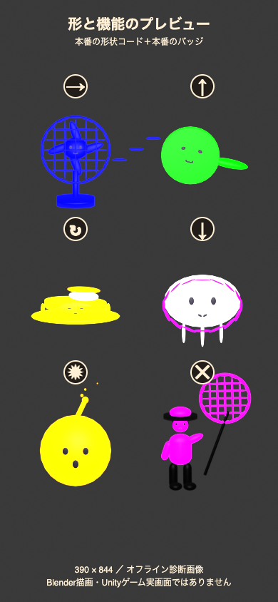

# NEON オブジェクト再設計 第5便：死亡演出と機能の読みやすさ

指定された演出層の修正とオフライン検証を完了。物理・効果量・配置中心・当たり判定は変更していない。6種の形状プレビューと死亡表示のHTML部品画像を添付する。Unity実ゲームの動き・WebGL実行品質の判定は今回のオフライン検証には含めていない。

- ブランチ：`object-redesign`、開始時clean。
- 基点：`428892f8c99197742341650a678b2c8c494ab804`。
- **実装・検証根拠コミット：`a3193ab47b3038818feae7af48ed8f422a1f1f44`**。本報告とコミット読戻し記録は後続の文書コミット。
- 実装コミット134ファイルをGitから読戻し、作業実体と全件byte一致。[読戻し記録](readability/implementation-readback.json)／[ソースSHA256](readability/source-sha256.json)／[証跡SHA256](readability/evidence-sha256.json)。
- push・公開・新しい配布ビルド・試遊URLの更新なし。

## Part A：かに漁師の捕獲演出

### 遷移仕様

実際のdeath接触で、物理側の終了・距離・粉砕数・記録確定は従来どおり即時に行う。表示専用の `ObjectCaptureTimeline` と `ObjectCaptureView` が次の順序を管理する。

| 表示状態 | 実時間の目安 | 表示・動き | 次へ進む条件 |
|---|---:|---|---|
| Hold | 700ms | 命中時のカメラ画像を保持 | 最初に実描画されたフレームから700ms経過 |
| Capture | 600ms | 漁師の網をカニへかぶせ、描画用カニを漁師側へ引き寄せる。小さな揺れを付ける | 捕獲時計が600ms経過 |
| Caption | 1200ms | 捕獲後の絵を保ち、大きな「かに漁師だ！」を表示 | 字幕時計が1200ms経過 |
| Result | 通常の結果画面 | 「かに漁師につかまった！」を1行表示 | 既存の再投操作 |

通常は合計約2.5秒。各状態は最低1描画フレームを経て進むため、低フレームレート時は長くなる。停止時間は描画の実開始から計測し、遅い最初のフレームで捕獲時間を消費しない。捕獲600msの最初の約120msで網をかぶせ、残りで滑らかに引き寄せる。揺れは最大0.07mの小さな描画変位で、終点で0へ戻す。

`ObjectHitStopRules.Death` は200→700ms。他5種の停止時間は不変。画像保持コンポーネントと既存の物理時計は不変。カニ本体やその子の物理Transformを動かさず、表示中のMeshRenderer／MeshFilterだけをコピーする。元のRendererを一時的に隠し、演出終了・設定変更・再投・無効化時に復元する。漁師も消費後の表示専用コピーで、ColliderやRigidbodyを追加しない。

結果カメラとWebGL Reportの表示phaseだけを捕獲終了まで待たせる。固定ステップ `Tick()` とNativeが読む `State()` の本文はbyte不変。通常終了では捕獲待ちも死因行も出さず、次の投げで字幕・コピー・死因が残らない。

演出オフ／OSモーション軽減／ゲーム側モーション軽減では、画像停止・網とカニの動き・deathパーティクルを省略する。「かに漁師だ！」を1200ms表示して結果へ進み、死因行を残す。途中で軽減へ切り替えた場合も動きを即解除して字幕へ進む。一時停止中は字幕時計を進めず、解除後は残り時間を使う。

字幕は通常の22〜32pxより大きい30〜46px（390px幅では約32px）、暖墨の地にクリーム文字。通常キャプション5種の1000msと既存の抑止条件は維持する。

[死亡字幕：演出オフ、390px](readability/capture-caption-off.png) ／ [結果の死因行、390px](readability/capture-result-normal.png)

## Part B：6種の見た目と動き

機能バッジは既存キャプションと同じHTML HUD経路へ追加した。実オブジェクトの中心をカメラへ投影し、**34×34px、27pxの太いグリフ、暖墨／クリーム**の円を表示する。最大32個のDOMノードを再利用。オブジェクトの回転・鏡像を継承しないので、spin中も正立する。消費済み・画面外・legacy・結果中は非表示。オフ／軽減でも機能情報として残す。

| 種別 | バッジ | 形・常時動作の変更 |
|---|---|---|
| boost／扇風機 | →（負方向は←） | 羽根720°/秒を保持。短い風の線3本を連続移動。既存の負X鏡像ルートが風の位置と進行方向も反転させ、両側とも外向き |
| bounce／フライパン | ↑ | 傾いたフライパンの描画子だけ、縦横約8%のsquash-stretch |
| spin／回転寿司 | ↻ | 皿180°/秒を保持。具材は旧配置が中心対称だったため、描画子だけX=0.16、Z=0.10へずらし、回転の向きを読める非対称配置へ変更 |
| brake／もち | ↓ | 白い本体と顔をまとめた描画子が約3.5%ゆっくり伸縮。下に細い粘りのストランド3本 |
| blast／花火玉 | ✹ | 導火線先から小さな火花3個を再利用して連続移動。既存の発光・2Hz周期・軽減時の一定発光は不変 |
| death／かに漁師 | ✕ | 網を高い位置へ構え、ゆっくり±8°に揺らす。既存の人型・帽子・長靴・顔を保持 |

追加の風と火花は固定3個ずつの軽い描画部品。毎フレームの生成・破棄、ParticleSystemの追加はない。全種128ノード未満の既存上限を維持。オフ／軽減では追加の伸縮・揺れ・火花・風を止める。物理ルートの既存運動は保全している。

### 全6種の形状プレビュー

上段：扇風機／フライパン、中段：回転寿司／もち、下段：花火玉／かに漁師。



本番 `ObjectVisual.Build/Pose` の記録をBlenderで診断描画し、本番 `juice-hud.js`／CSSのバッジをChromeで重ねたもの。**Unityの実ゲーム画面ではない**。本体色・発光値を変更しておらず、Standard材質のUnityでの見え方は別確認。[形状記録](readability/shape-record.json)／[描画スクリプト](readability/render-shapes.py)／[HUDプレビュー](readability/preview.cjs)／[34px計測](readability/preview-metrics.json)

## 検証結果

| 検査 | 結果 | 根拠 |
|---|---|---|
| Editor／WebGL条件分岐型検査 | 139ソース、errors **0／0**。既存warnings 18／17。Effekseer errors0／warnings0 | [compile.json](readability/compile.json)／[型検査ログ](readability/typecheck.log) |
| Native helper＋実importer型検査 | errors0／warnings0 | [ログ](readability/native-typecheck.log) |
| 全契約 | **1241 passed／0 failed**。既存1151件を維持し、同版ソース照合3件、軽減時death抑止3件、遷移・動作70件、境界14件を追加 | [件数照合](readability/verification-summary.json) |
| Playwright | **44 passed／0 failed／0 skipped／0 flaky**（既存37＋追加7） | [ログ](readability/playwright.log)／[JSON](readability/playwright.json) |
| 物理・設定等の保全 | 既存375ソースbyte不変。ObjectRules／ObjectRuntime、Tick／State不変 | [境界契約](readability/readability-contracts.json) |
| 保護26ファイル | 元source／worktree各26件、前後SHA256全一致、コミット対象0 | [前](readability/protected-before.json)／[後](readability/protected-after.json) |
| 目視 | 390pxの6種形状／6バッジ、死亡字幕／死因行を確認。320px・横画面の収まりも契約で確認 | [目視記録・不具合一覧](readability/visual-review.json) |

旧契約は削除・skipしていない。200ms死亡停止・1000ms死亡字幕の期待値を今回の指定へ更新し、過去の「全ソース不変」検査には今回の描画差分だけを厳密に差し戻して照合する。新規ファイルを追跡した後にも実行できるよう境界の許可リストを明示した。

最初の44件PASS後、ソース点検で軽減時に従来deathパーティクルが残る経路を見つけて修正。最終同版で型検査・全契約・44件を再実行した。修正前の結果は [before-reduced-death-fix](readability/before-reduced-death-fix/) に分離し、最終根拠へ混ぜていない。診断プレビューの上下反転と追加ラベルの重なりも修正し、初回画像を保持した。

実行コマンド・環境変数・終了コードは [commands.json](readability/commands.json)。`npm_config_offline=true` と既存のUnity付属Roslyn、Effekseer 1.80.8参照、ローカルPlaywright／Chromeを使用。

```sh
python3 docs/object-redesign/typecheck.py
python3 docs/object-redesign/story/contracts.py
python3 docs/object-redesign/blastfix/contracts.py
python3 docs/object-redesign/camhit/port-contracts.py
npx --no-install playwright test -c docs/object-redesign/readability/playwright.config.cjs
```

再実行時はcommands.jsonにある `KANI_*_EVIDENCE_DIR` と `NODE_PATH` を適用する。Playwrightから残りの既存契約と新規readability契約も実行される。遷移の実行契約は本番の時計・Drain／Report・画像保持経路を使うが、描画APIは記録用ダブル。HTML画像は合成state。PhysX投げやUnity GPU描画の代用証拠にはしていない。

## 残る確認

今回指定のオフライン範囲は完了。Unity起動／WebGLビルド／IL2CPP／実ゲームの網と引き寄せ／正式入力一巡／Native固定投げ／実聴／物理iPhone／FPS／Game Studio game-playtestは **NOT_RUN（今回範囲外）**。次工程は同実装commitの完全checkoutで、正負両方向のdeath接触→捕獲→結果→再投と、実ゲーム390px幅でのバッジ視認性、オフ／軽減を確認する。ゲーム全体の完成・本人採用・公開は判定していない。既知の床侵入・Collider残差・背景反復FAILは解消扱いにしていない。

既存tasks／HANDOFFへ保存。TEAM.mdは案件のKB読取り禁止により未確認、Studio指定入口は現行native catalog未接続。外部送信・Linear／KB更新・push・公開・課金・新認証・他セッションの再起動なし。
